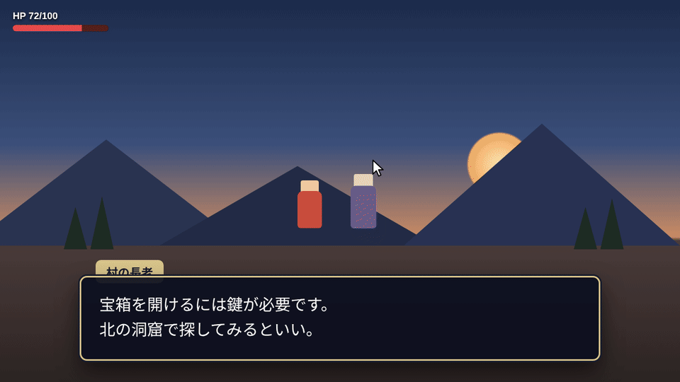
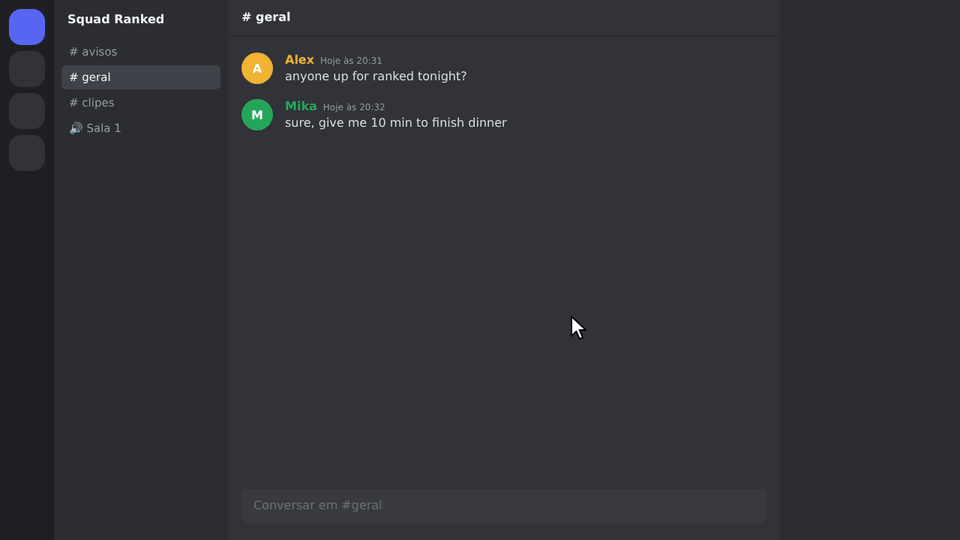
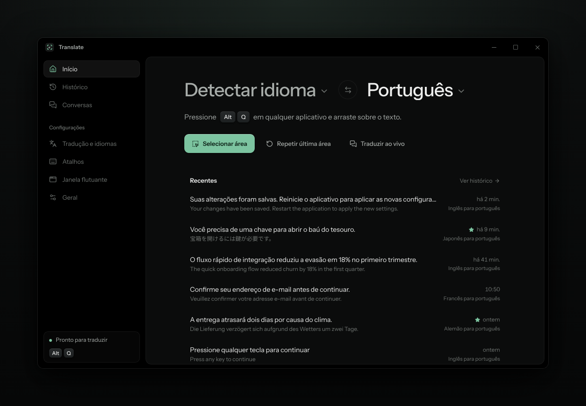
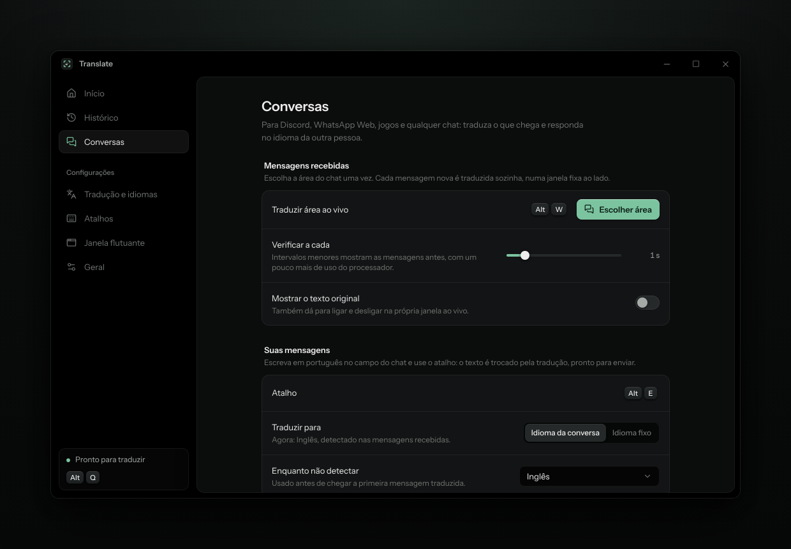
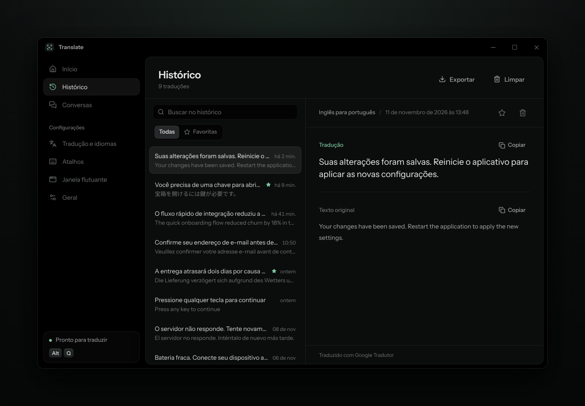
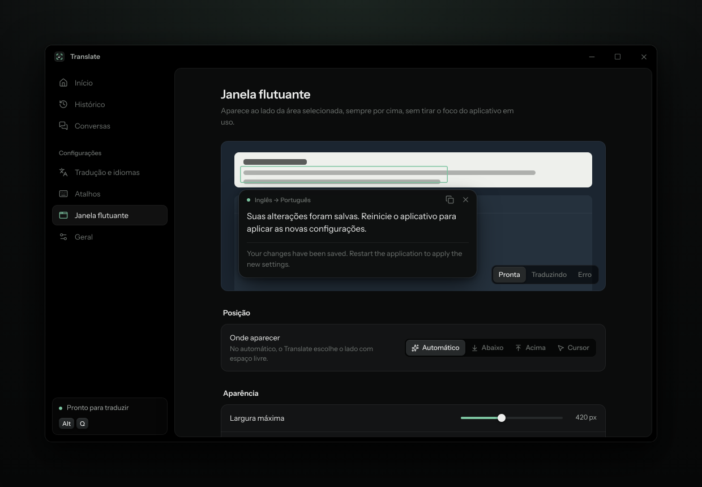

[Português](README.md) · **English**

---

<p align="center">
  
</p>

<p align="center">
  <a href="../../releases/latest"></a>
  <a href="../../releases/latest"></a>
  
  <a href="LICENSE"></a>
</p>

Translate translates any text on your screen. Press **Alt+Q**, drag over a game dialog, a menu, a subtitle or an image, and the translation shows up right next to it, without leaving what you were doing.

It also follows conversations: pick the Discord chat area and every new message arrives translated. To reply, write in your own language and press **Alt+E**: the text turns into the other person's language before you send it.

Found a bug or have an idea? [Open an issue](../../issues).

> [!NOTE]
> Runs on Windows 10 (version 2004 or newer) and Windows 11, 64-bit. The interface is in Brazilian Portuguese.

<p align="center">
  
</p>

## Features

- Select any area of the screen on a frozen frame: menus, tooltips and videos stay still while you choose.
- Text recognition by Windows itself, offline and fast, including Japanese, Chinese, Korean, Russian and more.
- A floating window next to the area, always on top, that never steals focus from your game or app.
- Live mode for chats and games: new messages are translated on their own, old ones are not translated again.
- Replies in the conversation language, detected from the messages you receive.
- Google Translate with no sign-up, or DeepL and Microsoft Translator with your own key.
- History with search, favorites and export to Excel (CSV) or JSON.
- Custom shortcuts, multiple monitors, mixed display scaling and a tray icon.

<p align="center">
  
</p>

## Installing

1. Download `Translate_1.0.0_x64-setup.exe` from the [releases page](../../releases/latest).
2. Run it and follow the steps. No administrator rights needed.
3. Translate opens and stays in the tray, next to the clock.

> [!CAUTION]
> The installer is not code-signed, so Windows may show a SmartScreen warning. Click **More info**, then **Run anyway**. Only download it from this repository's releases page.

### Shortcuts

| Shortcut | What it does |
|---|---|
| `Alt` + `Q` | Select an area and translate it |
| `Alt` + `Shift` + `Q` | Translate the last area again |
| `Alt` + `W` | Turn live mode on or off |
| `Alt` + `E` | Replace what you wrote with its translation |
| `Alt` + `Shift` + `T` | Show or hide the Translate window |

All of them can be changed in **Atalhos** (Shortcuts).

## Frequently asked questions

**Q:** Do I need to pay or create an account?
**A:** No. Google Translate works without one. DeepL and Microsoft are optional and have free plans.

**Q:** Does it work with games?
**A:** Yes, in windowed or borderless fullscreen. In exclusive fullscreen, Windows does not let other windows draw on top.

**Q:** It says the language is not installed for text recognition.
**A:** In **Tradução e idiomas**, click **Instalar** next to the language. Windows downloads the package and asks for administrator rights once.

**Q:** Does Alt+E send the message by itself?
**A:** No. It only replaces the text in the field. You review it and send it.

**Q:** Are my translations stored on a server?
**A:** No. History stays on your computer and API keys are kept in Windows Credential Manager.

## Screenshots

<p align="center">
  
  
</p>
<p align="center">
  
  
</p>

## Code

Built with [Tauri 2](https://tauri.app), Rust, React, TypeScript and Tailwind CSS.

### Run and build

You need [Node.js 20+](https://nodejs.org), [Rust](https://rustup.rs) and [Visual Studio Build Tools](https://visualstudio.microsoft.com/visual-cpp-build-tools/) with **Desktop development with C++**.

```
> npm install
> npm run tauri dev
```

To build the installer:

```
> npm run tauri build
```

The `.exe` ends up in `src-tauri/target/release/bundle/nsis/`. `scripts/build-windows.ps1` checks the requirements and does everything in one go.

To work only on the interface, `npm run dev` opens the app in the browser with sample data.

### How it works

```
Alt+Q
 ├─ captures every monitor before any window appears
 ├─ shows the frozen frame so you can select
 ├─ crops the area and gives focus back to the app you were using
 ├─ reads the text with Windows OCR and joins the lines of each paragraph
 ├─ translates (cached, with Google as a fallback)
 └─ shows the floating window next to the area without activating it
```

```
src-tauri/src/   Rust backend: capture, OCR, translation, live mode, history, shortcuts
src/             React interface: main window, selection and floating window
docs/            images for this README
```

### Tests

```
> cd src-tauri
> cargo test --lib
```

### License

[MIT](LICENSE).
