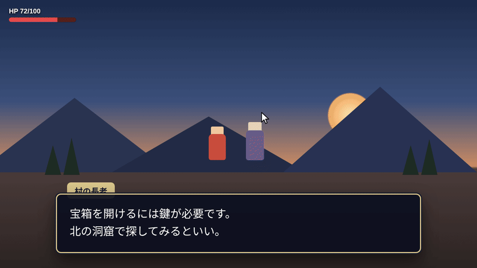
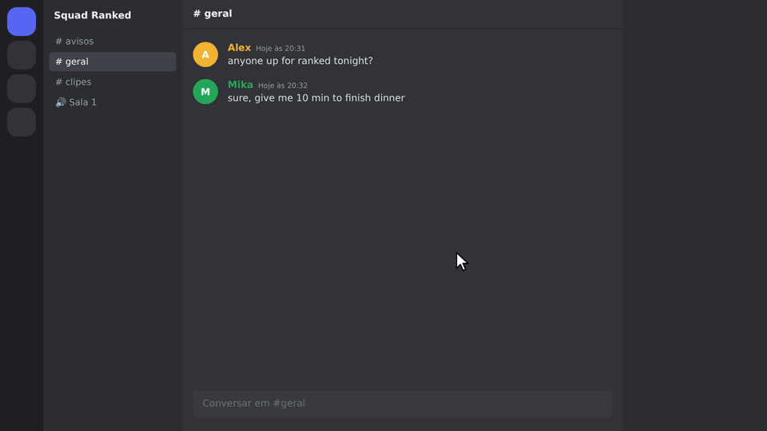
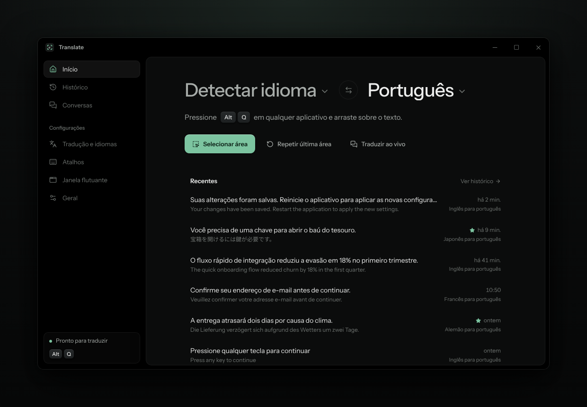
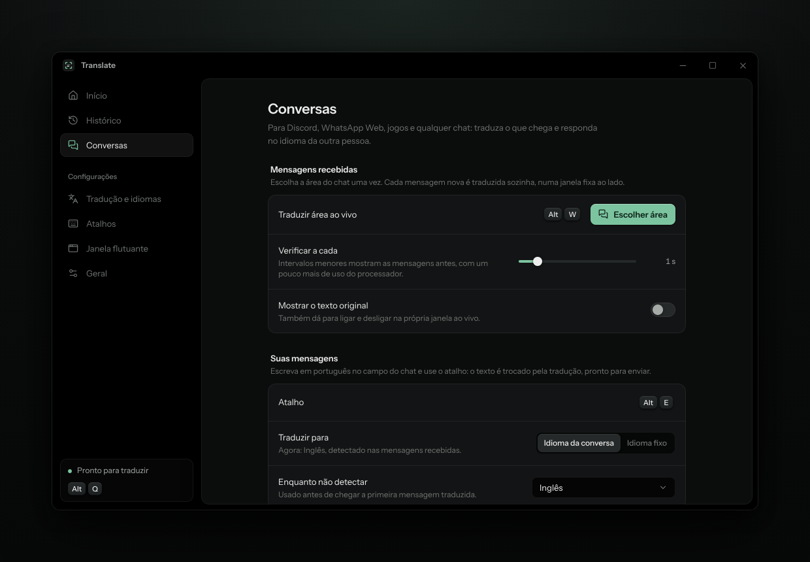
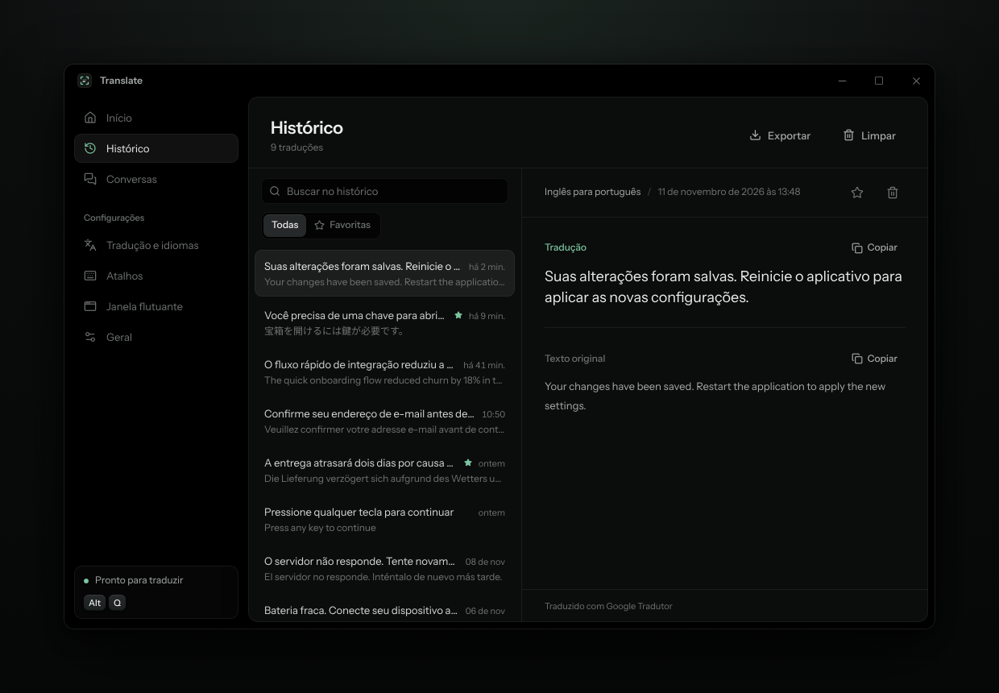
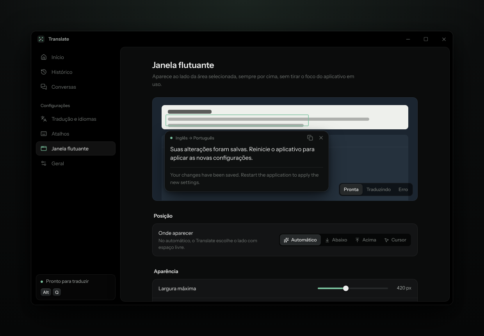

**Português** · [English](README.en.md)

---

<p align="center">
  
</p>

<p align="center">
  <a href="../../releases/latest"></a>
  <a href="../../releases/latest"></a>
  
  <a href="LICENSE"></a>
</p>

O Translate traduz qualquer texto que aparece na sua tela. Aperte **Alt+Q**, arraste sobre um diálogo de jogo, um menu, uma legenda ou uma imagem, e a tradução aparece ao lado, sem você sair do que estava fazendo.

Também acompanha conversas: escolha a área do chat do Discord e cada mensagem nova chega traduzida. Para responder, escreva em português e aperte **Alt+E**: o texto vira o idioma da outra pessoa antes de você enviar.

Achou um problema ou tem uma ideia? [Abra uma issue](../../issues).

> [!NOTE]
> Funciona no Windows 10 (versão 2004 ou mais nova) e no Windows 11, 64 bits.

<p align="center">
  
</p>

## Recursos

- Seleção de qualquer área da tela com a tela congelada: menus, dicas e vídeos não mudam enquanto você escolhe.
- Leitura de texto pelo próprio Windows, offline e rápida, com suporte a japonês, chinês, coreano, russo e outros.
- Janela flutuante que aparece ao lado da área, sempre por cima e sem roubar o foco do jogo ou programa aberto.
- Modo ao vivo para chats e jogos: as mensagens novas são traduzidas sozinhas, sem traduzir de novo as antigas.
- Respostas no idioma da conversa, detectado automaticamente pelas mensagens que você recebe.
- Google Tradutor sem cadastro, ou DeepL e Microsoft Translator com a sua chave.
- Histórico com busca, favoritos e exportação para Excel (CSV) ou JSON.
- Atalhos configuráveis, vários monitores, escalas de tela diferentes e ícone na bandeja.

<p align="center">
  
</p>

## Instalação

1. Baixe o instalador `Translate_1.0.0_x64-setup.exe` na página de [versões](../../releases/latest).
2. Abra o arquivo e siga os passos. Não precisa de permissão de administrador.
3. O Translate abre e fica no ícone da bandeja, perto do relógio.

> [!CAUTION]
> Como o instalador não tem assinatura digital paga, o Windows pode mostrar o aviso do SmartScreen. Clique em **Mais informações** e depois em **Executar assim mesmo**. Baixe sempre pela página de versões deste repositório.

### Atalhos

| Atalho | O que faz |
|---|---|
| `Alt` + `Q` | Seleciona uma área e traduz |
| `Alt` + `Shift` + `Q` | Traduz de novo a última área, sem selecionar |
| `Alt` + `W` | Liga e desliga o modo ao vivo |
| `Alt` + `E` | Troca o que você escreveu pela tradução |
| `Alt` + `Shift` + `T` | Mostra ou esconde a janela do Translate |

Todos podem ser trocados em **Atalhos**.

## Perguntas frequentes

**P:** Precisa pagar ou criar conta?
**R:** Não. O Google Tradutor funciona sem cadastro. DeepL e Microsoft são opcionais e têm planos gratuitos.

**P:** Funciona com jogos?
**R:** Sim, em modo janela ou tela cheia em janela (borderless). Em tela cheia exclusiva, o Windows não deixa outras janelas aparecerem por cima.

**P:** Apareceu "o idioma não está instalado para reconhecimento de texto".
**R:** Em **Tradução e idiomas**, clique em **Instalar** ao lado do idioma. O Windows baixa o pacote e pede permissão de administrador uma vez.

**P:** O Alt+E envia a mensagem sozinho?
**R:** Não. Ele só troca o texto no campo. Você confere e envia.

**P:** Minhas traduções ficam salvas em algum servidor?
**R:** Não. O histórico fica só no seu computador, e as chaves de API ficam no Gerenciador de Credenciais do Windows.

**P:** Como fecho o Translate de vez?
**R:** Clique com o botão direito no ícone da bandeja e escolha **Sair**. O X da janela só a esconde.

## Capturas de tela

<p align="center">
  
  
</p>
<p align="center">
  
  
</p>

## Código

Feito com [Tauri 2](https://tauri.app), Rust, React, TypeScript e Tailwind CSS.

### Rodar e compilar

Você vai precisar de [Node.js 20+](https://nodejs.org), [Rust](https://rustup.rs) e do [Build Tools do Visual Studio](https://visualstudio.microsoft.com/visual-cpp-build-tools/) com **Desenvolvimento para desktop com C++**.

```
> npm install
> npm run tauri dev
```

Para gerar o instalador:

```
> npm run tauri build
```

O `.exe` fica em `src-tauri/target/release/bundle/nsis/`. O script `scripts/build-windows.ps1` confere os requisitos e faz tudo de uma vez.

Para mexer só na interface, `npm run dev` abre o app no navegador com dados de exemplo.

### Como funciona

```
Alt+Q
 ├─ fotografa todos os monitores antes de qualquer janela aparecer
 ├─ mostra a imagem congelada para você selecionar
 ├─ recorta a área e devolve o foco ao programa que você usava
 ├─ lê o texto com o OCR do Windows e junta as linhas de cada parágrafo
 ├─ traduz (com cache e o Google como reserva)
 └─ mostra a janela flutuante ao lado da área, sem ativá-la
```

```
src-tauri/src/   backend em Rust: captura, OCR, tradução, modo ao vivo, histórico, atalhos
src/             interface em React: janela principal, seleção e janela flutuante
docs/            imagens deste README
```

### Testes

```
> cd src-tauri
> cargo test --lib
```

### Onde ficam os dados

| O quê | Onde |
|---|---|
| Configurações | `%APPDATA%\com.translate.desktop\settings.json` |
| Histórico | `%APPDATA%\com.translate.desktop\history.db` |
| Registros de erro | `%LOCALAPPDATA%\com.translate.desktop\logs\` |
| Chaves de API | Gerenciador de Credenciais do Windows |

### Licença

[MIT](LICENSE).
